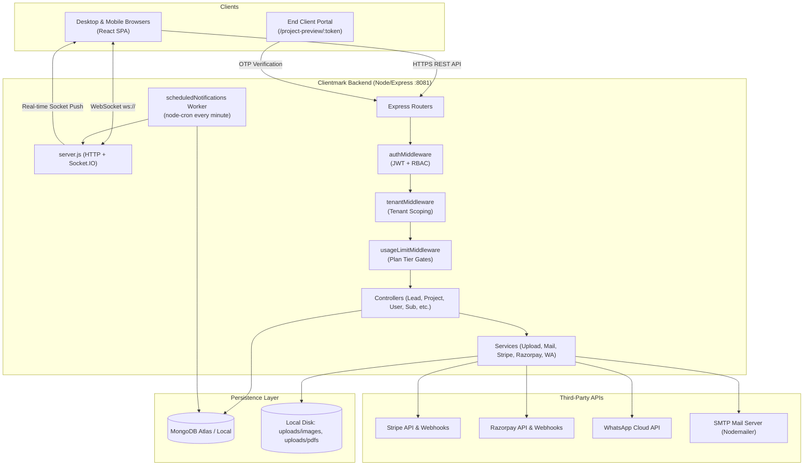
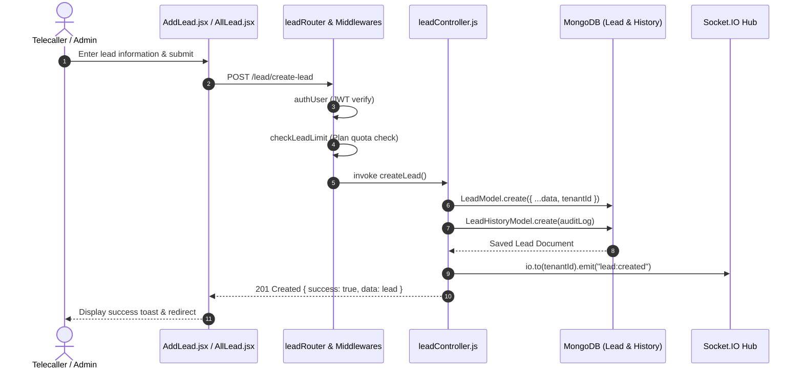
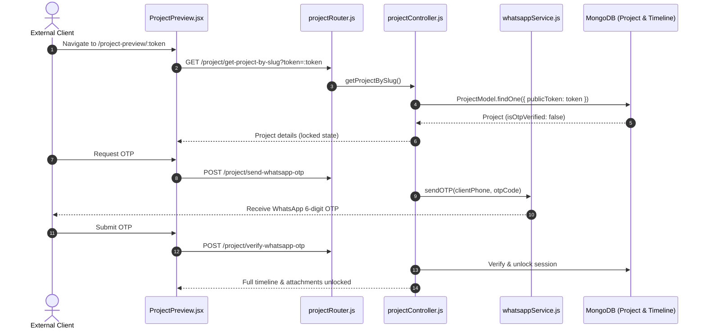
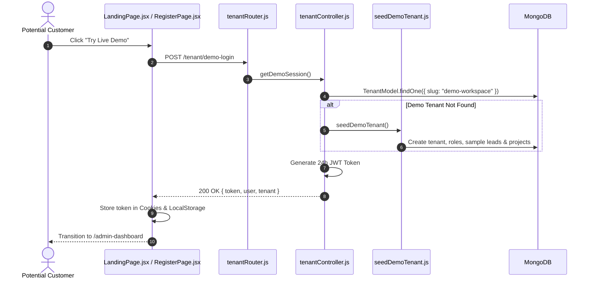
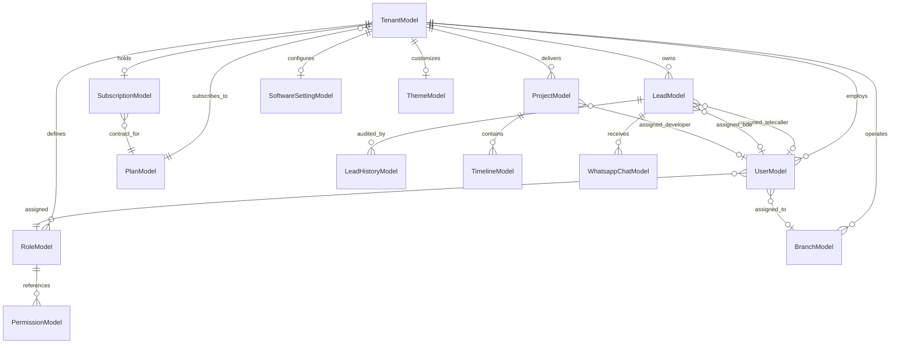

# Clientmark — Codebase Architecture & Flow Guide

Welcome to **Clientmark**. This document provides an exhaustive, end-to-end architecture and operational guide to this multi-tenant SaaS application. It is written to onboard new developers and to serve as a precise, code-grounded reference for engineers and automated systems.

---

## 1. Project Overview

**Clientmark** is a white-label, multi-tenant B2B SaaS CRM, Project Management, and Client Collaboration platform designed specifically for digital agencies, IT support companies, software consultancies, and freelance studios.

### Who Are the Users?
1. **Tenant Super Admins / Agency Owners:** Subscribe to plans, manage workspace branding, configure custom domain/SMTP/WhatsApp credentials, provision team members, and view executive analytics.
2. **Telecallers (Sales Development):** Handle lead qualification, call feedback logs, and convert prospects to warm status.
3. **Business Development Executives (BDEs):** Manage negotiated deals, transition warm leads into active projects, and assign timelines.
4. **Project Managers & Developers:** Manage delivery tasks, post timeline updates with file attachments, and track milestone deadlines.
5. **End Clients / External Customers:** Access a tokenized, OTP-secured external progress portal (`/project-preview/:token`) without needing an internal staff account.

### Core Value & Main Features
- **Multi-Tenant Architecture:** Strict workspace isolation where data (users, leads, projects, settings) is scoped by `tenantId`.
- **Granular RBAC (Role-Based Access Control):** Permissions are partitioned per tenant and mapped down to individual UI actions (`view:lead`, `add:project`, `delete:user`).
- **Lead Pipeline & Assignment:** Multi-stage lifecycle (`Admin -> Telecaller -> BDE -> Project`), Excel bulk import/export, status history audits.
- **Client Project Portal:** External preview links secured by WhatsApp/SMS OTP for real-time customer tracking and milestone approvals.
- **WhatsApp Integration:** Meta Cloud API integration for template messaging, OTP delivery, client chat logging, and customer link dispatches.
- **White-Label Customization:** Dynamic favicon switching, company logo upload, and live CSS hex theme switching.
- **Billing & Subscriptions:** Dual payment gateway support (Stripe & Razorpay) with plan tier feature gating and usage limits.
- **AI Workspace Assistant:** In-app floating chatbot that provides contextual workspace navigation and CRM support.

---

## 2. Tech Stack

### Backend Stack
| Layer / Service | Technology | Purpose | Key References |
| :--- | :--- | :--- | :--- |
| **Runtime & Server** | Node.js (ES Modules), Express.js `^5.2.1` | REST API, static asset hosting, middleware routing | [server.js](file:///d:/React_Project/crm/backend/server.js), [app.js](file:///d:/React_Project/crm/backend/config/app.js) |
| **Database** | MongoDB with Mongoose `^9.1.2` | Primary document database, schema definitions, indexes | [db.js](file:///d:/React_Project/crm/backend/config/db.js), [models/](file:///d:/React_Project/crm/backend/models) |
| **Real-time** | Socket.IO `^4.8.3` | Live notifications, user status, instant messaging | [socket.js](file:///d:/React_Project/crm/backend/config/socket.js) |
| **Security & Auth** | JSON Web Tokens (`jsonwebtoken`), `bcrypt`, `helmet`, `express-rate-limit`, `cors` | Token issuance, password hashing, security headers, rate limiting | [authMiddleware.js](file:///d:/React_Project/crm/backend/middlewares/authMiddleware.js) |
| **Payments** | Stripe (`^22.6.2`) & Razorpay (`^2.9.8`) | Subscription checkouts, recurring billing, webhooks | [stripeService.js](file:///d:/React_Project/crm/backend/services/stripeService.js), [razorpayService.js](file:///d:/React_Project/crm/backend/services/razorpayService.js) |
| **File Processing** | `multer` + `sharp` | Uploads for logos, avatars, PDFs, and timeline screenshots | [fileUploadService.js](file:///d:/React_Project/crm/backend/services/fileUploadService.js) |
| **Email Delivery** | `nodemailer` | Transactional emails (welcome, reset OTP, invoices) | [mailService.js](file:///d:/React_Project/crm/backend/services/mailService.js) |
| **Background Jobs** | `node-cron` | Periodic reminders, deadline checks, motivational quotes | [scheduledNotifications.js](file:///d:/React_Project/crm/backend/workers/scheduledNotifications.js) |
| **Spreadsheets** | `exceljs` | Bulk import & export of leads, users, and reports | [leadController.js](file:///d:/React_Project/crm/backend/controllers/leadController.js) |

### Frontend Stack
| Layer / Service | Technology | Purpose | Key References |
| :--- | :--- | :--- | :--- |
| **Framework** | React 18, React Router v6 | Single Page Application (SPA), client-side routing | [App.js](file:///d:/React_Project/crm/frontend/src/App.js), [index.js](file:///d:/React_Project/crm/frontend/src/index.js) |
| **UI Kit & Styling** | CoreUI React (`@coreui/react`), Bootstrap 5, SCSS | UI component kit, responsive grid, dynamic stylesheets | [style.scss](file:///d:/React_Project/crm/frontend/src/scss/style.scss) |
| **State Management** | React Context (`AuthContext`, `SocketContext`, `ThemeContext`) + LocalStorage | Authentication tokens, active socket connection, live theme | [AuthContext.js](file:///d:/React_Project/crm/frontend/src/AuthContext.js) |
| **Network Client** | Axios (`axiosClient.js`) | HTTP requests with Bearer token interceptors | [axiosClient.js](file:///d:/React_Project/crm/frontend/src/api/axiosClient.js) |
| **Notifications** | `react-hot-toast` | In-app toast alerts and operation status notifications | [DefaultLayout.js](file:///d:/React_Project/crm/frontend/src/layout/DefaultLayout.js) |
| **Analytics** | `@vercel/analytics` | Web analytics and telemetry | [App.js](file:///d:/React_Project/crm/frontend/src/App.js) |

---

## 3. Folder Structure

```
crm/
├── backend/                         # Express.js REST API & Background Workers
│   ├── config/                      # Express app setup, DB connection, auto-seeds, socket
│   │   ├── app.js                   # Express configuration, CORS, Helmet, static route mounts
│   │   ├── db.js                    # Mongoose connection logic
│   │   ├── seedDatabase.js          # Global seed data (Subscription Plans)
│   │   ├── seedDemoTenant.js        # Acme Digital Agency demo sandbox workspace
│   │   └── socket.js                # Socket.IO connection and event dispatchers
│   ├── controllers/                 # Business logic for all API endpoints
│   │   ├── branchController.js      # Office branch CRUD operations
│   │   ├── chatbotController.js     # AI assistant FAQ matcher & context answers
│   │   ├── leadController.js        # Lead pipeline, Excel import/export, stages, WhatsApp
│   │   ├── notificationController.js# User in-app notifications
│   │   ├── onboardingController.js  # First-time tenant setup wizard
│   │   ├── projectController.js     # Projects, timeline posts, client portal & OTP
│   │   ├── softwareSettingController.js # Theme colors, logo, and favicon management
│   │   ├── subscriptionController.js# Stripe & Razorpay orders, sessions, webhooks, usage
│   │   ├── tenantController.js      # Tenant registration, profiles, and demo sessions
│   │   ├── userController.js        # Users, roles, permissions, auth, password reset
│   │   └── whatsappCredController.js# Tenant WhatsApp Meta Cloud credentials & links
│   ├── middlewares/                 # Express pipeline gatekeepers
│   │   ├── authMiddleware.js        # JWT token verification & permission validation
│   │   ├── tenantMiddleware.js      # Tenant active status and subscription expiry checks
│   │   └── usageLimitMiddleware.js  # Tier limit guards (max leads, users, projects, branches)
│   ├── models/                      # 21 Mongoose schema definitions
│   ├── routers/                     # Route definitions mapping URLs to controllers
│   ├── services/                    # Reusable adapters (Email, WhatsApp, Stripe, Razorpay, Files)
│   ├── utils/                       # Common utilities (path resolution, date helpers)
│   ├── workers/                     # Cron background tasks
│   │   ├── mailWorker.js            # Async email dispatcher
│   │   └── scheduledNotifications.js# Minute-interval project & reminder monitor
│   ├── uploads/                     # Local storage for images and uploaded documents
│   └── server.js                    # Backend HTTP & WebSocket entry point
├── frontend/                        # React SPA (Vite / CRA based)
│   ├── public/                      # Static assets, fallback favicons, manifest
│   └── src/                         # Application source code
│       ├── api/                     # Axios instance configured with baseUrl and auth headers
│       ├── components/              # Reusable UI widgets (Header, Sidebar, Modals, Chatbot)
│       ├── helpers/                 # Dynamic favicon switcher, formatters
│       ├── layout/                  # DefaultLayout wrapper (Sidebar + Header + Content)
│       ├── routes.js                # Internal routes mapped to views and permission strings
│       ├── scss/                    # CoreUI and custom styles
│       ├── socket/                  # Client-side socket listeners
│       ├── views/                   # Page screens
│       │   ├── sidebarpages/        # All authenticated dashboard & settings views
│       │   └── sidebarCSS/          # Module-specific styling
│       ├── App.js                   # Top-level routing & context providers
│       ├── AuthContext.js           # Current user state and token management
│       ├── PermissionRoute.js       # Route-level RBAC authorization guard
│       ├── ProtectedRoute.js        # Unauthenticated redirection guard
│       └── SocketContext.js         # Global WebSocket hook
├── package.json                     # Monorepo root scripts
└── vercel.json                      # Frontend deployment configuration
```

---

## 4. Architecture Diagram



---

## 5. Entry Points & Startup Flow

### Backend Startup: [backend/server.js](file:///d:/React_Project/crm/backend/server.js)
1. **Environment Initialization:** Calls `dotenv.config()` to populate `process.env`.
2. **Database Connection:** Invokes `connectDB()` in [backend/config/db.js](file:///d:/React_Project/crm/backend/config/db.js).
3. **Automatic Seed Routines:**
   - `seedDatabase()` in [backend/config/seedDatabase.js](file:///d:/React_Project/crm/backend/config/seedDatabase.js) synchronizes the four global subscription tiers: `Free`, `Starter`, `Professional`, `Enterprise`.
   - `seedDemoTenant()` in [backend/config/seedDemoTenant.js](file:///d:/React_Project/crm/backend/config/seedDemoTenant.js) provisions the "Acme Digital Agency" demo workspace with default roles, permissions, leads, projects, and users.
4. **HTTP Server Setup:** Creates an HTTP server wrapping Express `app` defined in [backend/config/app.js](file:///d:/React_Project/crm/backend/config/app.js).
5. **Security Middleware Registration:**
   - `helmet` applies defensive HTTP headers.
   - `cors` with dynamic regex checks in `corsOriginChecker` validates authorized local and production origins.
   - `express.json({ limit: "2mb" })` captures JSON payloads and stores `rawBody` for webhook verification.
   - `generalLimiter` applies a default rate-limit of 100 requests/minute per IP.
6. **Router Mounting:** Static assets `/uploads/images` and `/uploads/pdfs` are mounted, followed by the 10 domain routers.
7. **Socket.IO Initialization:** Attaches Socket.IO to the HTTP server via `initializeSocket(io)` in [backend/config/socket.js](file:///d:/React_Project/crm/backend/config/socket.js) and sets `app.set("io", io)`.
8. **Background Cron Start:** Runs `initScheduledNotifications(io)` in [backend/workers/scheduledNotifications.js](file:///d:/React_Project/crm/backend/workers/scheduledNotifications.js).
9. **Port Listening:** Binds to `PORT` (defaults to `8080` or `8081`).

### Frontend Startup: [frontend/src/index.js](file:///d:/React_Project/crm/frontend/src/index.js)
1. **DOM Mount:** React 18 `createRoot` mounts the application into `document.getElementById('root')`.
2. **Provider Hierarchy:** In [frontend/src/App.js](file:///d:/React_Project/crm/frontend/src/App.js):
   - `<FaviconRouteSync />`: Monitors route changes; applies the custom tenant favicon inside the app, and reverts to the default Clientmark SVG on public landing routes (`/`).
   - `<ThemeProvider>`: Injects custom tenant accent colors and theme variables.
   - `<SocketProvider>`: Connects to the backend WebSocket server and manages connection states.
   - `<AuthProvider>`: Checks `js-cookie` for JWT token and fetches user profile details.
3. **Route Evaluation:** Directs public requests to `<Landing />`, `<Login />`, `<Register />`, or `<ProjectPreview />`, and protected requests to `<DefaultLayout />`.

---

## 6. Authentication & Authorization Flow

### 1. Tenant Registration (`POST /tenant/register`)
- **Controller:** `registerTenant` in [backend/controllers/tenantController.js](file:///d:/React_Project/crm/backend/controllers/tenantController.js).
- Creates a new `TenantModel` record with a unique slug and 14-day trial period.
- Creates a default `Super Admin` role in `RoleModel` with full permissions seeded from `PermissionModel`.
- Creates the primary tenant admin user in `UserModel` with hashed password (`bcrypt`).
- Generates a JWT token signed with `{ id, role, tenantId }` and returns it immediately for frictionless onboarding.

### 2. Standard Login (`POST /user/login-by-pass`)
- **Controller:** `loginByPass` in [backend/controllers/userController.js](file:///d:/React_Project/crm/backend/controllers/userController.js).
- Queries `UserModel` by email. Validates password via `bcrypt.compare`.
- Verifies that the associated `TenantModel` is `Active` and not suspended.
- Generates a signed JWT containing `id`, `role` (populated with permissions), and `tenantId`.
- Emits real-time notification to the user socket.

### 3. Demo Sandbox Login (`POST /tenant/demo-login`)
- **Controller:** `getDemoSession` in [backend/controllers/tenantController.js](file:///d:/React_Project/crm/backend/controllers/tenantController.js).
- Enables 1-click evaluation without signup.
- Finds or provisions `demo-workspace`, fetches the demo admin account, and issues a 24-hour JWT token.

### 4. Password Reset Flow
- **Request OTP:** `POST /user/send-mail-otp` generates a 6-digit numeric OTP, saves it in `OtpModel` with a 15-minute expiration, and delivers it via `mailService.js`.
- **Verify & Reset:** `POST /user/verity-email-otp` validates the OTP, verifies the reset token, updates the user's password with a fresh `bcrypt` hash, and deletes the consumed OTP.

### 5. Middleware Pipeline
```
Incoming HTTP Request
   │
   ▼
[authMiddleware: authUser] ──► Checks Authorization: Bearer <token>
   │                          Decodes JWT, populates req.user and req.tenantId
   ▼
[tenantMiddleware]        ──► Validates TenantModel is Active & unexpired
   │
   ▼
[authMiddleware: authAccess]► Checks if req.user.role.permissions has required permission code
   │
   ▼
[usageLimitMiddleware]    ──► Checks Plan limits (maxLeads, maxUsers, maxProjects, maxBranches)
   │
   ▼
[Controller Handler]      ──► Scopes all queries by { tenantId: req.tenantId }
```

---

## 7. Core Feature Flows

### Flow 1: Lead Creation & Pipeline Lifecycle
1. **UI Action:** User submits form in [AddLead.jsx](file:///d:/React_Project/crm/frontend/src/views/sidebarpages/AddLead.jsx).
2. **API Call:** `POST /lead/create-lead` via [axiosClient.js](file:///d:/React_Project/crm/frontend/src/api/axiosClient.js).
3. **Middlewares:**
   - `authUser`: Validates JWT token and extracts `req.tenantId`.
   - `checkLeadLimit`: Queries active lead count for `req.tenantId` against `tenant.planId.limits.maxLeads`. Rejects with `403` if limit reached.
4. **Controller:** `createLead` in [leadController.js](file:///d:/React_Project/crm/backend/controllers/leadController.js).
5. **Database Action:**
   - Creates document in `LeadModel` with `tenantId: req.tenantId`, default stage (`Admin`), and metadata.
   - Creates initial audit record in `LeadHistoryModel`.
6. **Assignment:** Admin assigns lead to telecaller via `POST /lead/many-admin-to-telecaller`. Lead stage transitions to `Telecaller`.
7. **BDE Escalation:** Telecaller submits call feedback; lead transitions via `POST /lead/single-telecaller-to-bde`.



---

### Flow 2: Project Management & Client Timeline Portal
1. **Creation:** BDE creates project via `POST /project/create-project` in [AddProject.jsx](file:///d:/React_Project/crm/frontend/src/views/sidebarpages/AddProject.jsx). Project receives a unique URL slug and an auto-generated 64-character public access token.
2. **Timeline Updates:** Developers post progress entries with attachments via `POST /project/:projectId/timeline` using `upload.array('attachments', 2)` (processed by Sharp).
3. **Client Access:**
   - Client visits `/project-preview/:token`.
   - Frontend calls `GET /project/get-project-by-slug?token=...`.
   - Backend queries `ProjectModel.findOne({ publicToken: token })`.
   - If OTP is required, client clicks "Send OTP" (`POST /project/send-whatsapp-otp`). Backend dispatches a 6-digit OTP to client's phone via `whatsappService.js`.
   - Client submits OTP (`POST /project/verify-whatsapp-otp`). Once validated, full timeline documents and milestone statuses are unlocked.



---

### Flow 3: Tenant Registration & Demo Sandbox Provisioning
1. **Visitor Action:** User visits landing page `/` and clicks **"Try Demo"** or **"Register"**.
2. **Demo Click:** Hits `POST /tenant/demo-login`.
3. **Backend Logic:**
   - `getDemoSession` in [tenantController.js](file:///d:/React_Project/crm/backend/controllers/tenantController.js) finds `demo-workspace`.
   - Generates JWT containing `{ id: demoAdmin._id, role: demoAdmin.role, tenantId: demoTenant._id }`.
4. **Cookie & Redirection:** JWT stored in `token` cookie; frontend transitions into `/admin-dashboard`.
5. **Banner:** `DemoBanner.jsx` displays sandbox notice with expiration countdown.



---

### Flow 4: Billing & Subscription Upgrades (Stripe / Razorpay)
1. **User Action:** Admin navigates to `/billing` ([BillingPage.jsx](file:///d:/React_Project/crm/frontend/src/views/sidebarpages/BillingPage.jsx)) and selects a plan (Starter, Professional, Enterprise) and billing interval (monthly/yearly).
2. **Checkout Initiation:**
   - **Stripe:** `POST /subscription/stripe/create-checkout-session` generates a Stripe Checkout URL with `client_reference_id = tenantId`. Admin is redirected to Stripe.
   - **Razorpay:** `POST /subscription/create-order` creates an order via `razorpayService.js` and returns order details to the Razorpay modal.
3. **Webhook Verification (Stripe):**
   - Stripe sends `checkout.session.completed` to `POST /subscription/stripe/webhook`.
   - Middleware extracts `req.rawBody` and validates signature via `stripe.webhooks.constructEvent()`.
   - Webhook checks `WebhookEventModel` to guarantee idempotent processing.
   - Updates `SubscriptionModel` to `Active` and updates `TenantModel.planId` and `subscriptionEnd`.
4. **Webhook Verification (Razorpay):**
   - Frontend posts signature to `POST /subscription/verify-payment`.
   - Backend calculates HMAC SHA256 signature using `RAZORPAY_KEY_SECRET`.
   - Updates tenant subscription status upon verification.

---

### Flow 5: WhatsApp Notification & Automated Scheduled Reminder
1. **Direct Notification:** Staff sends a message via `POST /lead/send-whatsapp`. `whatsappService.js` dispatches the payload to Meta's Cloud API endpoint and records the interaction in `WhatsappChatModel`.
2. **Cron Worker:** [scheduledNotifications.js](file:///d:/React_Project/crm/backend/workers/scheduledNotifications.js) triggers every minute (`* * * * *`).
3. **Worker Processing:**
   - Scans `ProjectModel` for milestones due within 24 hours.
   - Scans `LeadModel` for scheduled follow-up dates matching the current timestamp.
   - Creates unread entries in `NotificationModel` scoped to each user.
   - Pushes real-time alerts via `io.to(tenantId).emit("notification:new", payload)`.

---

## 8. Data Model

The application uses **21 Mongoose models** located in [backend/models/](file:///d:/React_Project/crm/backend/models).

### Model Descriptions
| Model | Key Fields | Purpose |
| :--- | :--- | :--- |
| **`TenantModel`** | `companyName`, `slug`, `email`, `planId`, `status`, `settings` | Root workspace entity for multi-tenancy. |
| **`UserModel`** | `userName`, `email`, `password`, `role`, `tenantId`, `branchId` | Individual staff members within a tenant. |
| **`RoleModel`** | `roleName`, `tenantId`, `permissionId` (array of refs) | RBAC role definitions scoped per tenant. |
| **`PermissionModel`** | `permissionName`, `index`, `tenantId`, `subPermission` | Fine-grained capability definitions (`code` strings). |
| **`PlanModel`** | `planName`, `price`, `limits` (`maxLeads`, `maxUsers`, etc.) | Subscription plan definitions and quota gates. |
| **`SubscriptionModel`** | `tenantId`, `planId`, `provider`, `status`, `startDate`, `endDate` | Active billing contracts and renewal schedules. |
| **`WebhookEventModel`** | `eventId`, `provider`, `eventType`, `processedAt` | Idempotency log preventing duplicate webhook runs. |
| **`LeadModel`** | `name`, `email`, `phone`, `currentStage`, `leadStatus`, `tenantId` | Prospective customer tracking records. |
| **`LeadHistoryModel`** | `leadId`, `tenantId`, `sender`, `receiver`, `note`, `stage` | Immutable timeline audit of lead stage changes. |
| **`ProjectModel`** | `projectName`, `clientName`, `slug`, `publicToken`, `tenantId` | Active client project delivery workspaces. |
| **`TimelineModel`** | `projectId`, `title`, `description`, `attachments`, `tenantId` | Milestone progress updates with file attachments. |
| **`BranchModel`** | `branchName`, `branchLocation`, `tenantId` | Physical office locations for multi-branch agencies. |
| **`NotificationModel`** | `userId`, `tenantId`, `title`, `message`, `isRead` | In-app user notifications and cron alerts. |
| **`OtpModel`** | `email`, `otp`, `expiresAt`, `tenantId` | Ephemeral 6-digit tokens for email and password reset. |
| **`SoftwareSettingModel`**| `tenantId`, `projectName`, `mainLogo`, `favicon`, `phone` | Tenant branding, contact info, and site settings. |
| **`ThemeModel`** | `tenantId`, `mainTheme` (hex code) | Dynamic brand theme color customizations. |
| **`WorkspacePreferencesModel`** | `tenantId`, `industry`, `teamSize`, `primaryGoal` | Answers from the first-time onboarding wizard. |
| **`ChatbotConversationModel`** | `tenantId`, `sessionId`, `role`, `content` | History of AI assistant chat sessions. |
| **`WhatsappCredModel`** | `tenantId`, `phoneNumberId`, `accessToken`, `isActive` | Meta Cloud API credentials per tenant. |
| **`WhatsappChatModel`** | `tenantId`, `leadId`, `sender`, `message`, `status` | Audit log of outbound WhatsApp communications. |
| **`WhatsappTemplateModel`**| `tenantId`, `templateName`, `content`, `category` | Reusable WhatsApp notification templates. |

### Entity-Relationship Diagram



### Multi-Tenant Data Isolation Strategy
- **Partitioning Field:** Every business collection contains a mandatory `tenantId: { type: mongoose.Schema.Types.ObjectId, ref: 'Tenant' }`.
- **Enforcement:** [tenantMiddleware.js](file:///d:/React_Project/crm/backend/middlewares/tenantMiddleware.js) extracts `req.tenantId` from verified JWT claims. Controllers inject `{ tenantId: req.tenantId }` into all `find`, `findOne`, `create`, `update`, and `delete` queries.
- **Cross-Tenant Prevention:** Direct object access by ID (e.g., `getLeadById`, `deleteProject`) strictly validates both `_id` and `tenantId` to prevent IDOR vulnerabilities.

---

## 9. Billing & Subscription Flow

### Plan Tiers & Resource Limits
Defined in [seedDatabase.js](file:///d:/React_Project/crm/backend/config/seedDatabase.js):
- **Free:** ₹0/mo — Up to 3 users, 100 leads, 1 branch, 5 projects. No WhatsApp, no report exports.
- **Starter:** ₹999/mo (₹9,990/yr) — Up to 10 users, 1,000 leads, 2 branches, 20 projects. WhatsApp enabled, reports enabled.
- **Professional:** ₹2,499/mo (₹24,990/yr) — Up to 50 users, 10,000 leads, 10 branches, 100 projects. WhatsApp enabled, priority support.
- **Enterprise:** ₹4,999/mo (₹49,990/yr) — Unlimited users, unlimited leads, unlimited branches, unlimited projects. Full API access.

### Usage Gating Middleware: [usageLimitMiddleware.js](file:///d:/React_Project/crm/backend/middlewares/usageLimitMiddleware.js)
Before creating a resource, the router runs pre-flight quota checks:
- `checkLeadLimit`: `LeadModel.countDocuments({ tenantId }) < limits.maxLeads`
- `checkUserLimit`: `UserModel.countDocuments({ tenantId }) < limits.maxUsers`
- `checkProjectLimit`: `ProjectModel.countDocuments({ tenantId }) < limits.maxProjects`
- `checkBranchLimit`: `BranchModel.countDocuments({ tenantId }) < limits.maxBranches`

If the quota is exceeded, the server halts execution with HTTP `403 Forbidden` and a structured payload: `{ success: false, message: "Lead limit reached for your plan. Please upgrade." }`.

---

## 10. Background Jobs, Webhooks & Integrations

### 1. Cron Worker: [scheduledNotifications.js](file:///d:/React_Project/crm/backend/workers/scheduledNotifications.js)
- **Schedule:** `* * * * *` (Every minute).
- **Execution:**
  - Queries active tenants.
  - Inspects `ProjectModel` milestones due within 24 hours.
  - Inspects `LeadModel` records with pending follow-ups.
  - Inserts notifications into `NotificationModel` and emits WebSocket event `notification:new`.

### 2. Stripe Webhook: `POST /subscription/stripe/webhook`
- Requires raw body verification using `process.env.STRIPE_WEBHOOK_SECRET`.
- Handled events:
  - `checkout.session.completed`: Activates subscription contract.
  - `invoice.payment_succeeded`: Renews billing period end date.
  - `customer.subscription.deleted`: Reverts tenant to the `Free` plan.

### 3. Razorpay Webhook: `POST /subscription/webhook`
- Validates signature using `RAZORPAY_WEBHOOK_SECRET`.
- Updates tenant subscription upon `order.paid`.

### 4. WhatsApp Cloud API: [whatsappService.js](file:///d:/React_Project/crm/backend/services/whatsappService.js)
- Delivers template messages and OTP verification codes using HTTPS requests to `graph.facebook.com`.
- Tenant credentials fall back to environment defaults if custom credentials are not provided.

---

## 11. API Reference Summary

| Method | Path | Purpose | Auth Required | File Location |
| :--- | :--- | :--- | :--- | :--- |
| `POST` | `/tenant/register` | Register new tenant workspace | Public | [tenantRouter.js](file:///d:/React_Project/crm/backend/routers/tenantRouter.js) |
| `POST` | `/tenant/demo-login` | 1-Click Sandbox demo session | Public | [tenantRouter.js](file:///d:/React_Project/crm/backend/routers/tenantRouter.js) |
| `GET` | `/tenant/my-tenant` | Get current tenant profile | `authUser` | [tenantRouter.js](file:///d:/React_Project/crm/backend/routers/tenantRouter.js) |
| `POST` | `/user/login-by-pass` | Staff login by email & password | Public | [userRouter.js](file:///d:/React_Project/crm/backend/routers/userRouter.js) |
| `GET` | `/user/get-login-user-detail` | Get authenticated user info | `authUser` | [userRouter.js](file:///d:/React_Project/crm/backend/routers/userRouter.js) |
| `POST` | `/user/create-user` | Create staff member | `authUser` + `add:user` | [userRouter.js](file:///d:/React_Project/crm/backend/routers/userRouter.js) |
| `GET` | `/user/get-user-list` | List team members | `authUser` + `view:user` | [userRouter.js](file:///d:/React_Project/crm/backend/routers/userRouter.js) |
| `DELETE` | `/user/delete-user` | Delete staff member | `authUser` + `delete:user` | [userRouter.js](file:///d:/React_Project/crm/backend/routers/userRouter.js) |
| `POST` | `/user/send-mail-otp` | Request password reset OTP | Public | [userRouter.js](file:///d:/React_Project/crm/backend/routers/userRouter.js) |
| `POST` | `/user/verity-email-otp`| Verify OTP and set new password | Public | [userRouter.js](file:///d:/React_Project/crm/backend/routers/userRouter.js) |
| `POST` | `/lead/create-lead` | Create lead (checks quota) | `authUser` | [leadRouter.js](file:///d:/React_Project/crm/backend/routers/leadRouter.js) |
| `GET` | `/lead/get-leads` | Paginated lead list with filters | `authUser` + `view:lead` | [leadRouter.js](file:///d:/React_Project/crm/backend/routers/leadRouter.js) |
| `POST` | `/lead/import-lead` | Import leads from Excel file | `authUser` + Quota | [leadRouter.js](file:///d:/React_Project/crm/backend/routers/leadRouter.js) |
| `GET` | `/lead/export-lead` | Export leads to Excel sheet | `authUser` | [leadRouter.js](file:///d:/React_Project/crm/backend/routers/leadRouter.js) |
| `POST` | `/lead/many-admin-to-telecaller` | Assign leads to telecaller | `authUser` | [leadRouter.js](file:///d:/React_Project/crm/backend/routers/leadRouter.js) |
| `POST` | `/lead/single-telecaller-to-bde` | Escalate lead to BDE | `authUser` | [leadRouter.js](file:///d:/React_Project/crm/backend/routers/leadRouter.js) |
| `POST` | `/lead/send-whatsapp` | Send WhatsApp message to lead | `authUser` | [leadRouter.js](file:///d:/React_Project/crm/backend/routers/leadRouter.js) |
| `POST` | `/project/create-project` | Create new delivery project | `authUser` + Quota | [projectRouter.js](file:///d:/React_Project/crm/backend/routers/projectRouter.js) |
| `GET` | `/project/get-projects` | List projects | `authUser` + `view:project` | [projectRouter.js](file:///d:/React_Project/crm/backend/routers/projectRouter.js) |
| `POST` | `/project/:projectId/timeline` | Add progress post + image upload | `authUser` | [projectRouter.js](file:///d:/React_Project/crm/backend/routers/projectRouter.js) |
| `GET` | `/project/get-project-by-slug` | Public client portal preview | Public | [projectRouter.js](file:///d:/React_Project/crm/backend/routers/projectRouter.js) |
| `POST` | `/project/send-whatsapp-otp` | Send client portal access OTP | Public | [projectRouter.js](file:///d:/React_Project/crm/backend/routers/projectRouter.js) |
| `POST` | `/project/verify-whatsapp-otp` | Verify client portal OTP | Public | [projectRouter.js](file:///d:/React_Project/crm/backend/routers/projectRouter.js) |
| `GET` | `/subscription/plans` | List available subscription plans | Public | [subscriptionRouter.js](file:///d:/React_Project/crm/backend/routers/subscriptionRouter.js) |
| `GET` | `/subscription/my-plan` | Current tenant subscription status| `authUser` | [subscriptionRouter.js](file:///d:/React_Project/crm/backend/routers/subscriptionRouter.js) |
| `POST` | `/subscription/stripe/create-checkout-session` | Create Stripe checkout session | `authUser` | [subscriptionRouter.js](file:///d:/React_Project/crm/backend/routers/subscriptionRouter.js) |
| `POST` | `/subscription/stripe/webhook` | Process Stripe async webhooks | Stripe Signature | [subscriptionRouter.js](file:///d:/React_Project/crm/backend/routers/subscriptionRouter.js) |
| `GET` | `/software-setting/get-site-setting` | Fetch tenant logo and settings | Optional Auth | [softwareSettingRouter.js](file:///d:/React_Project/crm/backend/routers/softwareSettingRouter.js) |
| `POST` | `/software-setting/update-site-setting` | Update branding (logo/favicon) | `authUser` + `update:site-setting` | [softwareSettingRouter.js](file:///d:/React_Project/crm/backend/routers/softwareSettingRouter.js) |
| `POST` | `/chatbot/message` | Query in-app AI assistant | Public / Session | [chatbotRouter.js](file:///d:/React_Project/crm/backend/routers/chatbotRouter.js) |

---

## 12. Frontend Structure

### Layout Architecture
- **`App.js`**: Core entry point configuring providers (`Theme`, `Socket`, `Auth`) and routing.
- **`DefaultLayout.js`**: Shell layout wrapping authenticated views. Houses:
  - `<AppSidebar />`: Navigational sidebar populated from `_nav.js` and filtered by the user's permissions.
  - `<AppHeader />`: Header with user profile menu, notification bell, and breadcrumbs.
  - `<AppContent />`: Renders child route matched from `routes.js`.
  - `<DemoBanner />`: Visual reminder when operating inside a demo sandbox.
  - `<ChatbotWidget />`: Floating AI workspace support widget.
  - `<OnboardingWizard />`: Initial setup modal for newly registered agencies.

### Route Protection System
1. **`ProtectedRoute.js`**: Verifies presence of the `token` cookie. Unauthenticated users are redirected to `/login`.
2. **`PermissionRoute.js`**: Checks if the user's role contains the required permission code (e.g., `view:lead`). Unauthorized users are redirected to `/dashboard`.

### State Management & Data Fetching
- **`AuthContext.js`**: Manages `user`, `role`, `permissions`, and `tenant` state. Provides `login()` and `logout()` helpers.
- **`SocketContext.js`**: Maintains singleton WebSocket connection. Exposes `socket` instance to components for live updates.
- **`ThemeContext.js`**: Fetches active brand color from `/software-setting/get-main-theme` and injects CSS custom properties.
- **`axiosClient.js`**: Configures base API URL (`VITE_BASE_URL` or fallback `http://localhost:8081`). Attaches `Authorization: Bearer <token>` to outbound requests and handles 401 token expiration errors.

---

## 13. Configuration & Environment

### Backend Environment Variables (`backend/.env`)
| Variable | Description |
| :--- | :--- |
| `PORT` | HTTP port the server listens on (e.g., `8080` or `8081`). |
| `MONGO_URI` | MongoDB connection URI string (Local or MongoDB Atlas). |
| `JWT_SECRET` | Secret key used to sign and verify JSON Web Tokens. |
| `ALLOWED_ORIGINS` | Comma-separated list of authorized web origins for CORS. |
| `FRONTEND_URL` | Base URL of the deployed frontend SPA (e.g., `https://clientmark.app`). |
| `DOMAIN_URL` | Domain URL for client portal link generation. |
| `RAZORPAY_KEY_ID` | Razorpay API key ID for subscription checkouts. |
| `RAZORPAY_KEY_SECRET` | Razorpay API secret key for HMAC signature validation. |
| `RAZORPAY_WEBHOOK_SECRET` | Secret used to verify incoming Razorpay webhook events. |
| `STRIPE_SECRET_KEY` | Stripe secret API key (`sk_live_...` or `sk_test_...`). |
| `STRIPE_WEBHOOK_SECRET` | Stripe signing secret (`whsec_...`) for webhook validation. |
| `EMAIL_HOST` | SMTP server host (e.g., `smtp.gmail.com`). |
| `EMAIL_PORT` | SMTP port (e.g., `587` or `465`). |
| `EMAIL_USER` | SMTP username / sender email. |
| `EMAIL_PASS` | SMTP application password. |
| `WHATSAPP_PHONE_NUMBER_ID` | Meta Cloud API default Phone Number ID. |
| `WHATSAPP_ACCESS_TOKEN` | Meta Cloud API permanent system user access token. |

### Frontend Environment Variables (`frontend/.env`)
| Variable | Description |
| :--- | :--- |
| `VITE_BASE_URL` | Base URL of the backend API (e.g., `http://localhost:8081`). |
| `VITE_SOCKET_URL` | WebSocket server URL for Socket.IO. |

### How to Run Locally

1. **Prerequisites:** Ensure Node.js (v18+) and MongoDB are installed and running locally.
2. **Backend Setup:**
   ```powershell
   cd backend
   npm install
   # Configure backend/.env with MONGO_URI and JWT_SECRET
   node server.js
   ```
   *Expected output: `Server running on port 8081` & `MongoDB Connected..!`*

3. **Frontend Setup:**
   ```powershell
   cd frontend
   npm install
   npm run start
   ```
   *Frontend dev server will open at `http://localhost:3000` or `http://localhost:3001`.*

---

## 14. Deployment & Infrastructure

- **Frontend Hosting:** Configured for Vercel via [vercel.json](file:///d:/React_Project/crm/vercel.json). Includes rewrite rules redirecting all paths to `index.html` to support client-side SPA routing.
- **Backend Hosting:** Suitable for deployment on Render, Railway, AWS EC2, or DigitalOcean Droplets using PM2 (`pm2 start server.js --name clientmark-api`).
- **Database:** MongoDB Atlas with Mongoose replica sets recommended for production.
- **Persistent Storage Warning:** The application currently stores uploaded files (`uploads/images`, `uploads/pdfs`) on the local filesystem. For production deployments on ephemeral platforms (Heroku, Render, AWS ECS), migrate file storage to AWS S3, Cloudflare R2, or Google Cloud Storage using an S3 adapter in [fileUploadService.js](file:///d:/React_Project/crm/backend/services/fileUploadService.js).

---

## 15. Code Quality Observations

### Strengths
- **Rigorous Multi-Tenancy:** Controllers and database queries consistently scope records by `tenantId`.
- **Dynamic White-Labeling:** The combination of `dynamicFavicon.js` and `ThemeContext.js` provides instant tenant branding without page reloads.
- **Webhook Safety:** Idempotent processing in `subscriptionController.js` via `WebhookEventModel` prevents duplicate subscription extensions.
- **Fallback Resilience:** Graceful fallbacks exist for both Stripe and Razorpay, ensuring payments work across different regions.

### Technical Debt & Areas for Improvement
- **Automated Tests:** Currently, there are no Jest/Mocha integration tests in `backend/` or React Testing Library tests in `frontend/`. Adding an automated test suite should be the highest engineering priority.
- **Controller File Sizes:** [leadController.js](file:///d:/React_Project/crm/backend/controllers/leadController.js) (68 KB) and [projectController.js](file:///d:/React_Project/crm/backend/controllers/projectController.js) (42 KB) contain mixed responsibilities (CSV parsing, reporting, validation, queries). These should be refactored into smaller service modules.
- **Local File Storage:** Uploads are written directly to local disk paths. Containerized deployments will lose uploaded files on restarts unless a shared volume or cloud object store is attached.

---

## 16. Open Questions / Unclear Areas

1. **Meta WhatsApp Verification:** The backend supports custom WhatsApp credentials per tenant in `WhatsappCredModel`, but production verification requires Meta Business verification and registered template approvals.
2. **Client OTP Delivery Method:** The client portal verification flow in `projectController.js` currently relies on WhatsApp OTP delivery. If a client's number is not registered on WhatsApp, SMS fallback (via Twilio or AWS SNS) is not currently implemented.
3. **Automated Database Backups:** MongoDB auto-seeding routines run on server restart. In production, ensure migrations do not accidentally overwrite live customer data.

---

## 17. Suggested Reading Order

For a new developer onboarding onto Clientmark, read these 14 files in this exact order:

1. [backend/server.js](file:///d:/React_Project/crm/backend/server.js) — The backend entry point; shows how DB, Sockets, Cron, and Express are orchestrated.
2. [backend/config/app.js](file:///d:/React_Project/crm/backend/config/app.js) — Middleware pipeline, security headers, CORS origin checks, and router mounts.
3. [backend/middlewares/authMiddleware.js](file:///d:/React_Project/crm/backend/middlewares/authMiddleware.js) — Authentication mechanism, JWT verification, and RBAC permission checks.
4. [backend/middlewares/tenantMiddleware.js](file:///d:/React_Project/crm/backend/middlewares/tenantMiddleware.js) — Multi-tenant scoping and subscription status guards.
5. [backend/middlewares/usageLimitMiddleware.js](file:///d:/React_Project/crm/backend/middlewares/usageLimitMiddleware.js) — Plan limits enforcement on leads, users, projects, and branches.
6. [backend/models/tenantModel.js](file:///d:/React_Project/crm/backend/models/tenantModel.js) & [backend/models/userModel.js](file:///d:/React_Project/crm/backend/models/userModel.js) — Core data schemas for tenants and staff members.
7. [backend/controllers/tenantController.js](file:///d:/React_Project/crm/backend/controllers/tenantController.js) — Tenant registration and demo sandbox provisioning.
8. [backend/controllers/leadController.js](file:///d:/React_Project/crm/backend/controllers/leadController.js) — The primary CRM workflow: lead creation, assignment stages, and Excel handling.
9. [backend/controllers/projectController.js](file:///d:/React_Project/crm/backend/controllers/projectController.js) — Project execution, timeline entries, and public client preview portal.
10. [backend/controllers/subscriptionController.js](file:///d:/React_Project/crm/backend/controllers/subscriptionController.js) — Dual Stripe/Razorpay payment flows and webhook handlers.
11. [frontend/src/App.js](file:///d:/React_Project/crm/frontend/src/App.js) — Frontend root component, provider hierarchy, and route definitions.
12. [frontend/src/AuthContext.js](file:///d:/React_Project/crm/frontend/src/AuthContext.js) — Frontend authentication state, cookie tokens, and user session management.
13. [frontend/src/routes.js](file:///d:/React_Project/crm/frontend/src/routes.js) — Application route registry and RBAC permission mappings.
14. [frontend/src/helpers/dynamicFavicon.js](file:///d:/React_Project/crm/frontend/src/helpers/dynamicFavicon.js) — Dynamic white-label favicon and branding switcher.
